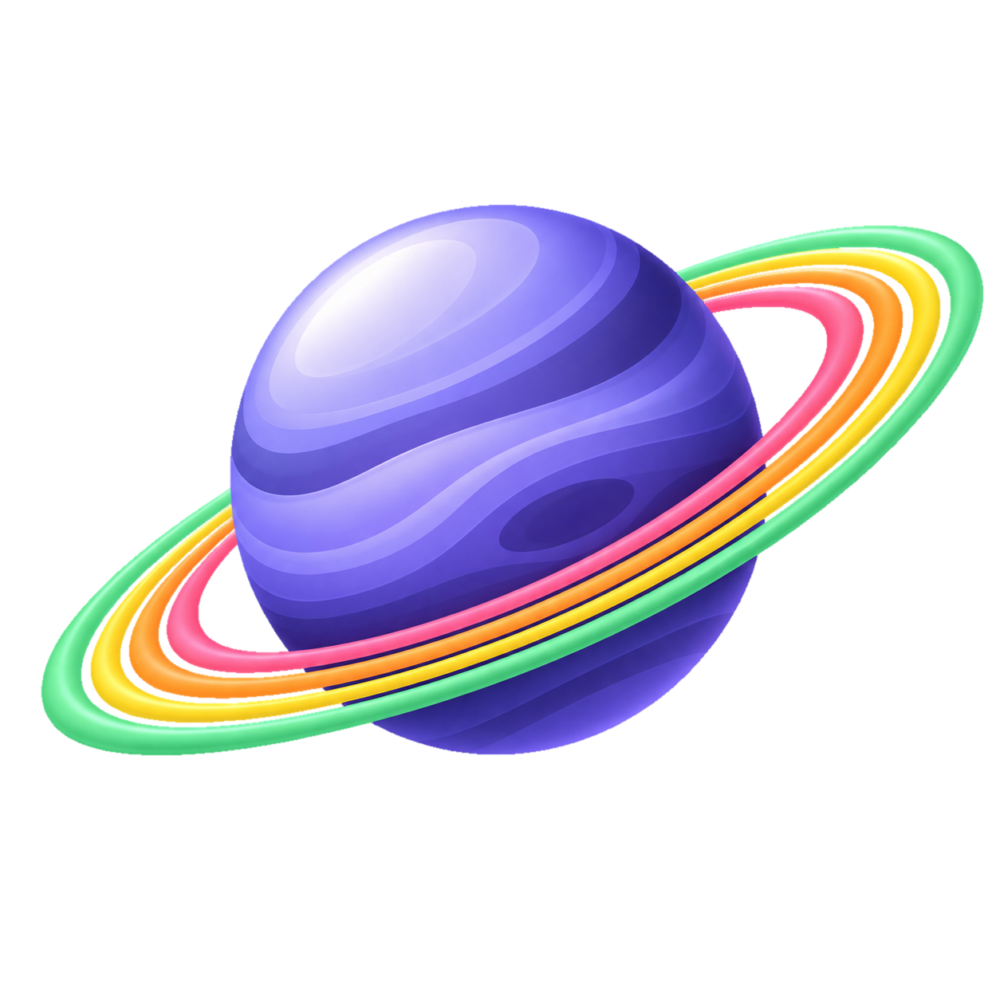
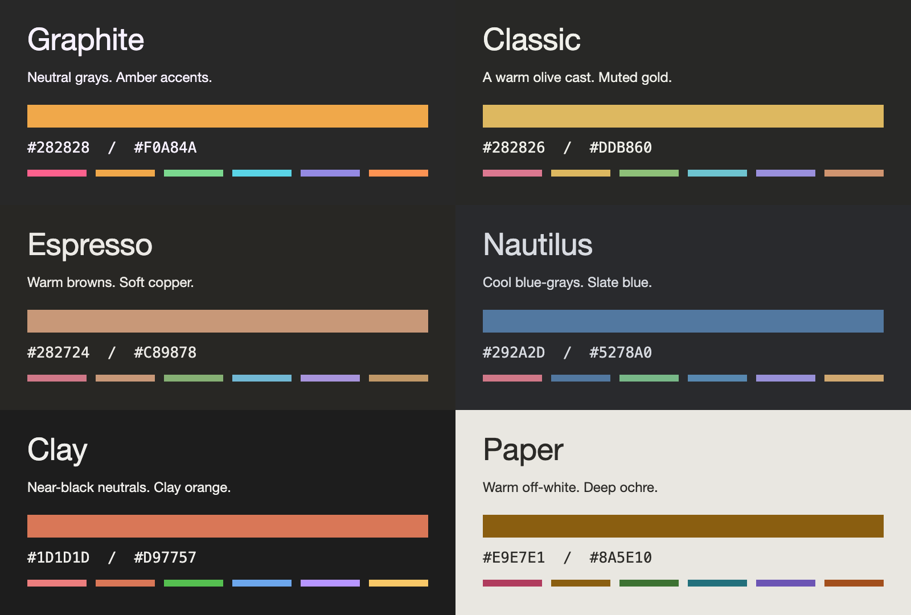

<p align="center">
  
</p>

<h1 align="center">Zenkai</h1>

<p align="center">
  <strong>Less noise. More code.</strong><br />
  A muted take on Monokai Pro, with five dark palettes for VS Code.
</p>

<p align="center">
  <a href="#four-ways-to-settle-in">Palettes</a> ·
  <a href="#get-started">Installation</a> ·
  <a href="#make-it-yours">Settings</a> ·
  <a href="https://github.com/Glvent/Zenkai">Source</a>
</p>

---

## Five ways to settle in

The same syntax language, with a different atmosphere around it. Each variant pairs quiet surfaces with distinct colors for strings, keywords, functions, types, and numbers.



_An overview of the bundled palette colors, not an editor screenshot._

| Theme               | Character                      | Editor background | Accent    |
| ------------------- | ------------------------------ | ----------------- | --------- |
| **Zenkai Graphite** | Neutral grays and amber        | `#282828`         | `#f0a84a` |
| **Zenkai Classic**  | Warm olive and muted gold      | `#282826`         | `#ddb860` |
| **Zenkai Espresso** | Warm browns and soft copper    | `#282724`         | `#c89878` |
| **Zenkai Nautilus** | Cool blue-grays and slate blue | `#292a2d`         | `#5278a0` |
| **Zenkai Clay**     | Near-black, clay accent        | `#1d1d1d`         | `#d97757` |
| **Zenkai Paper**    | Light warm paper and ochre     | `#e9e7e1`         | `#8a5e10` |

### Color where it counts

- **A restrained workbench.** Subtle surface changes and minimal active-item borders keep the interface quiet.
- **Accents with a purpose.** Selections, links, changes, and errors have their own place in the palette.
- **A matching terminal.** ANSI colors follow the selected variant, alongside its syntax and workbench colors.

## Get started

1. Install the Zenkai `.vsix` file using **Extensions: Install from VSIX…** in the Command Palette.
2. Run **Preferences: Color Theme**.
3. Choose **Zenkai Graphite**, **Zenkai Classic**, **Zenkai Espresso**, **Zenkai Nautilus**, **Zenkai Clay**, or the light **Zenkai Paper**.

Open the Command Palette with **⌘⇧P** on macOS or **Ctrl+Shift+P** on Windows and Linux. If Zenkai is already installed, start at step 2.

Requires **VS Code 1.60 or later**. Terminal location matching requires **1.91 or later**.

<details>
<summary><strong>Build and install from source</strong></summary>

Clone the [repository](https://github.com/Glvent/Zenkai), then run these commands from its root:

```sh
cd themes/vscode
npm install
npm run install:local
```

This builds and tests the extension, creates a VSIX, and installs it through an available VS Code CLI. It does not bump the version. If no CLI is available, install the generated `.vsix` with **Extensions: Install from VSIX…** instead.

</details>

## Make it yours

Choose a palette first, then adjust these optional settings in **Settings → Extensions → Zenkai**, or add them to your user `settings.json`:

```json
{
	"zenkai.popupTransparency": 0.85,
	"zenkai.terminalMatchLocation": true
}
```

| Setting                        | Default | What it changes                                                                                                                                                               |
| ------------------------------ | ------- | ----------------------------------------------------------------------------------------------------------------------------------------------------------------------------- |
| `zenkai.popupTransparency`     | `1`     | Popup opacity for menus, dropdowns, hovers, and suggestions. `1` is fully opaque; values between `0` and `1` add transparency. `0` leaves the bundled popup colors unchanged. |
| `zenkai.terminalMatchLocation` | `false` | **Experimental · VS Code 1.91+.** Lets the terminal background follow its host panel, sidebar, or editor area.                                                                |

### Accent

Each variant has its own accent preset setting. The default keeps the bundled accent; presets recolor interface highlights (selections, active tab and panel text, find borders, and similar). Syntax colors are unchanged.

| Setting                  | Default             | Presets                                                                    |
| ------------------------ | ------------------- | -------------------------------------------------------------------------- |
| `zenkai.accent.graphite` | Default (`#f0a84a`) | Sand `#e6c88a`, Copper `#d98b5f`, Steel `#7fa7cf`, Sage `#a6bf8f`          |
| `zenkai.accent.classic`  | Default (`#ddb860`) | Olive `#b5b86a`, Khaki `#cdb98a`, Rust `#c97f56`, Moss `#8fae7a`           |
| `zenkai.accent.espresso` | Default (`#c89878`) | Caramel `#d8a65c`, Cinnamon `#c0784e`, Latte `#d6bfa0`, Rosewood `#c48f8f` |
| `zenkai.accent.nautilus` | Default (`#5278a0`) | Teal `#4f9a9a`, Sky `#7ab0d8`, Seafoam `#7fb8a4`, Indigo `#7b84c4`         |
| `zenkai.accent.clay`     | Default (`#d97757`) | Kraft `#d4a27f`, Crail `#c15f3c`, Claude Blue `#6a9bcc`, Sage `#a3b18a`    |
| `zenkai.accent.paper`    | Default (`#8a5e10`) | Rust `#a3471f`, Navy `#2f5d8a`, Forest `#3f6e3a`, Plum `#7a4a7e`           |

`zenkai.accentCustomColor` takes a `#RRGGBB` value, overrides the preset for every Zenkai theme, and is blank by default.

```json
{
	"zenkai.accent.clay": "Crail"
}
```

Settings take effect while a Zenkai theme is active. The extension applies theme-scoped overrides in `workbench.colorCustomizations`, preserving unrelated customizations.

---

Zenkai is a fork of [Monokai Pro](https://monokai.pro/vscode), with a quieter workbench and its own variant palettes.

[Report an issue](https://github.com/Glvent/Zenkai/issues) · [Zed edition](https://github.com/Glvent/Zenkai/tree/main/themes/zed) · [Chrome edition](https://github.com/Glvent/Zenkai/tree/main/themes/chrome)
